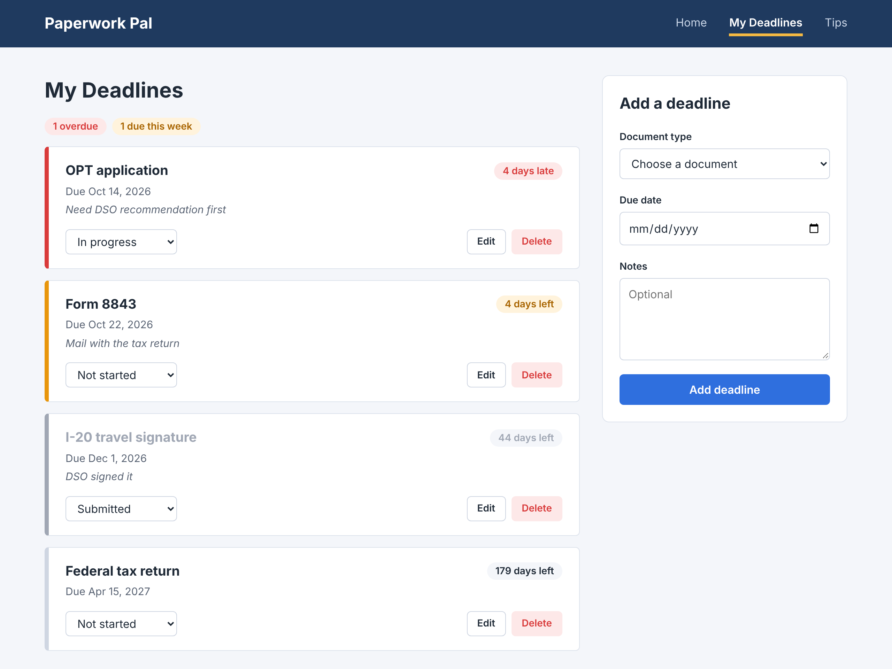

# Paperwork Pal

A deadline tracker and community tips board for international students in the US, covering the immigration and tax deadlines that can put a student's status at risk if missed.

**Live app:** https://paperwork-pal-one.vercel.app



## Authors

- **Ashwin Bhat** ([@ashwin-bhat-neu](https://github.com/ashwin-bhat-neu)): My Deadlines (`deadlines` collection, API, and page)
- **Mohammed Sameer Sarfaraz Bake** ([@sameer08055](https://github.com/sameer08055)): Tips board (`tips` collection, API, and page)

## Class

[CS 5610 Web Development (Online), Fall 2026](https://johnguerra.co/classes/webDevelopment_online_fall_2026/index.html), Northeastern University Oakland, taught by John Alexis Guerra Gómez.

## Project objective

Official sites explain the immigration and tax rules but not what the process is really like, and generic calendar apps know nothing about these deadlines. Paperwork Pal has two parts:

- **My Deadlines:** a personal tracker. Add each deadline with its document type, due date, and notes, and see them sorted by urgency with the days remaining.
- **Tips:** a community board where students who have been through a process share what they wish they had known.

Tips are labeled unverified and are not legal advice. The [design document](docs/design-document.md) has the personas, user stories, and mockups.

## How to use it

1. Open **My Deadlines** and fill in the form: document type, due date, and any notes.
2. Deadlines are listed soonest first with the days left. Overdue deadlines are red, deadlines due within a week are amber, and the counts appear at the top.
3. Change a deadline's status from its dropdown as you file. **Edit** loads it into the form; **Delete** asks for confirmation first.
4. Open **Tips** to browse advice by process or share your own.

There are no accounts. The browser creates an anonymous ID on first visit, so your deadlines and tips are tied to that browser.

## Tech stack

- **Frontend:** HTML5, CSS3, vanilla JavaScript (ES modules), Fetch API, client-side rendering
- **Backend:** Node.js 22 and Express 5, using ES modules
- **Database:** MongoDB Atlas with the native Node.js driver
- **Hosting:** Vercel
- **Tooling:** ESLint, Prettier, and the built-in `node:test` runner

## Build and run locally

Requires Node.js 22 and a MongoDB connection string. A free MongoDB Atlas cluster works.

```bash
git clone https://github.com/ashwin-bhat-neu/paperwork-pal.git
cd paperwork-pal
npm install
cp .env.example .env      # then set MONGODB_URI to your connection string
npm run seed:deadlines    # optional: adds 1,200+ sample deadlines and the database index
npm run dev
```

The app runs at http://localhost:3000, and http://localhost:3000/api/health returns `{"status":"ok"}` when the database is reachable.

| Script                   | What it does                                      |
| ------------------------ | ------------------------------------------------- |
| `npm run dev`            | Starts the server and restarts it on file changes |
| `npm start`              | Starts the server                                 |
| `npm run seed:deadlines` | Replaces the sample deadlines (safe to run again) |
| `npm test`               | Runs the unit tests                               |
| `npm run lint`           | Runs ESLint                                       |
| `npm run format`         | Formats every file with Prettier                  |
| `npm run format:check`   | Checks formatting without changing files          |

## Deploying

1. In MongoDB Atlas, create a database user and allow network access from `0.0.0.0/0`
2. Import the GitHub repository into Vercel. No build settings are needed.
3. Add a `MONGODB_URI` environment variable with the Atlas connection string, then deploy.

## API

Every deadlines route requires an `X-Owner-Id` header and only reads or changes that owner's deadlines.

| Method   | Route                | Purpose                              |
| -------- | -------------------- | ------------------------------------ |
| `GET`    | `/api/deadlines`     | List deadlines sorted by due date    |
| `POST`   | `/api/deadlines`     | Create a deadline                    |
| `PATCH`  | `/api/deadlines/:id` | Update the status or any other field |
| `DELETE` | `/api/deadlines/:id` | Delete a deadline                    |
| `GET`    | `/api/health`        | Check that the database is reachable |

## Project structure

```
app.js, server.js        Express app (exported for Vercel) and local server
db/                      MongoDB connection and collection queries
routes/                  Express routers
middleware/              Owner ID check and JSON error handlers
validation/              Request validation, independent of the database
scripts/                 Seed data generation
public/                  Static pages, images, and browser code
  css/                   One stylesheet per component, grouped by page
  js/shared/             Owner ID, fetch wrapper, and DOM helper
  js/deadlines/          My Deadlines page modules
test/                    Unit tests, mirroring the source folders
docs/                    Design document
assets/images/           Mockups and screenshot
```

## License

[MIT](LICENSE)
