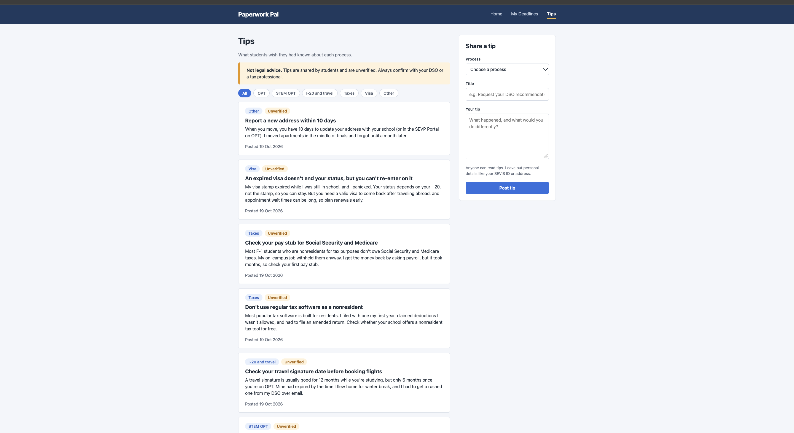
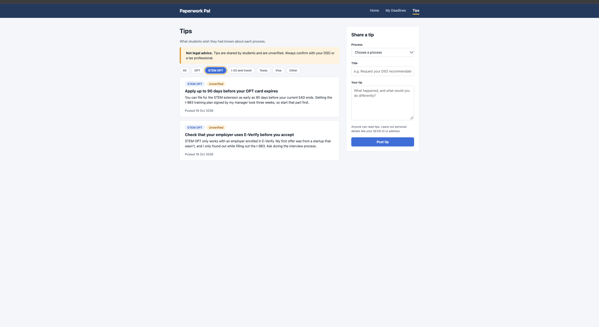
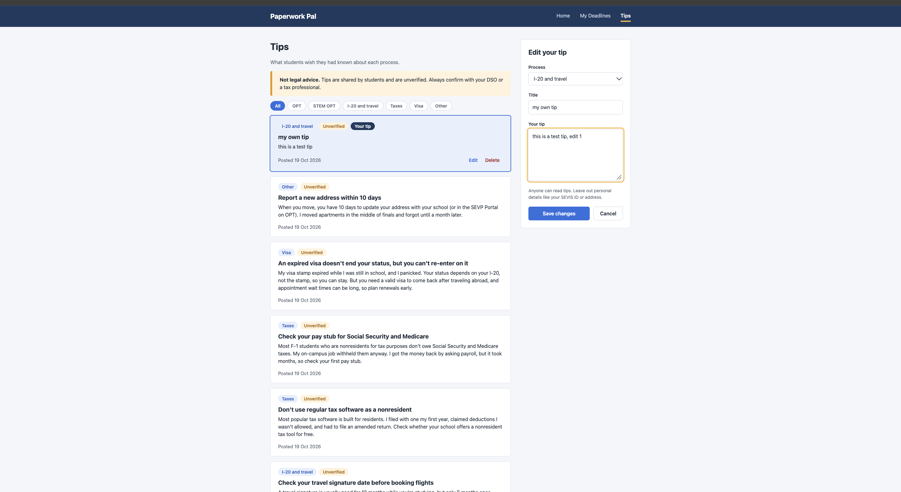
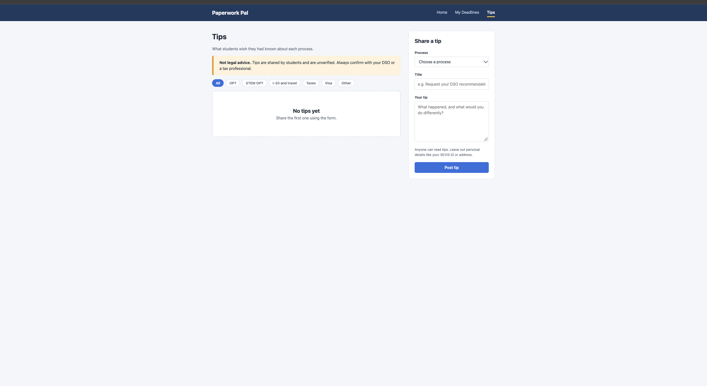
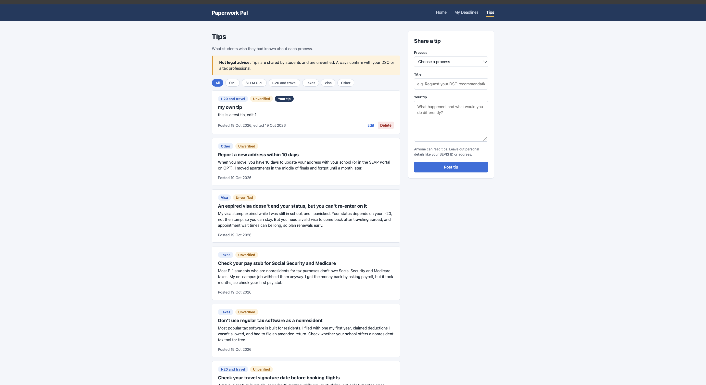

# Paperwork Pal: Design Document

## Project description

Paperwork Pal helps international students in the US keep track of the immigration and tax deadlines that can put their status at risk if missed. Official sites explain the rules but not what the process is really like, and generic calendar apps know nothing about these deadlines.

The app has two parts:

- **My Deadlines**: a personal tracker. A student adds each deadline with its document type, due date, and notes, and sees them sorted by urgency with the days remaining.
- **Tips**: a community board where students who have been through a process share what they wish they had known. Tips are public to read, labeled unverified, and are not legal advice.

There is no login. Each browser generates an anonymous ID on first visit and sends it with every request, so users see and edit only their own deadlines and tips.

### Team and work division

| Member                        | Feature   | Collection  | Scope                                                                  |
| ----------------------------- | --------- | ----------- | ---------------------------------------------------------------------- |
| Ashwin Bhat                   | Deadlines | `deadlines` | Deadline CRUD, sorted view with days remaining, status updates         |
| Mohammed Sameer Sarfaraz Bake | Tips      | `tips`      | Tip CRUD (public read, author-only edit and delete), filter by process |

Each of us builds the full stack for our own feature: MongoDB collection, Express routes, and vanilla JavaScript frontend.

### Tech stack

- **Frontend:** HTML5, CSS3, vanilla JavaScript (ES modules), Fetch API, client-side rendering
- **Backend:** Node.js and Express
- **Database:** MongoDB with the native Node.js driver
- **Deployment:** Vercel, with MongoDB Atlas

## User personas

### Mei, an F-1 student

Mei is a master's student about to apply for OPT. Her program end date, her DSO's OPT recommendation, her I-765 filing window, and her first US tax filing all land within a few months of each other. She keeps track of them across emails, a notes app, and a university portal, and she is afraid of missing a window she won't get back.

- **Goal:** one place that shows what is due soon and how much time is left.
- **Frustration:** generic calendars don't know which forms matter, and the official pages don't say what to do first.

### Arjun, a recent graduate

Arjun finished his degree last year and is now working on OPT. He made several avoidable mistakes along the way, such as waiting too long to request his DSO recommendation and not knowing he had to file Form 8843 in a year with no income.

- **Goal:** share what he learned so newer students don't repeat his mistakes.
- **Frustration:** advice is scattered across group chats and gets lost.

## User stories

### Deadlines (Ashwin)

#### 1. Add a deadline

> As Mei, I want to add a deadline with a document type, due date, and notes, so I can keep everything I need to file in one place.

Mei's DSO tells her she has to request an OPT recommendation before she can file Form I-765. She opens **My Deadlines**, picks "OPT application" from the document type list, enters the date she is aiming for, and writes "Need DSO recommendation first" in the notes. The deadline appears in her list right away, without a page reload.

- Document type comes from a fixed list (OPT application, STEM OPT extension, I-20 travel signature, Form 8843, federal and state tax returns, visa renewal, SEVP address update, other).
- Due date is required. Notes are optional.
- The deadline is stored under Mei's anonymous ID and nobody else can see it.

#### 2. See deadlines sorted by urgency

> As Mei, I want to see my deadlines sorted by due date with the days remaining, so I can spot the most urgent one.

On Monday morning Mei opens the page. Her deadlines are listed soonest first. Each card shows how many days are left, or how many days late it is. Overdue deadlines are marked red and deadlines due within a week are marked amber, so she sees at a glance that her OPT application is three days past the date she set and that Form 8843 is due Thursday.

- Sorted by due date, ascending.
- Days remaining are counted in calendar days from the user's local date.
- A summary at the top counts overdue deadlines and deadlines due this week.

#### 3. Update or delete a deadline

> As Mei, I want to update a deadline's status or delete it, so my list stays accurate.

After she mails Form 8843, Mei changes its status from "Not started" to "Submitted", and the card fades so it no longer competes for attention. Later she notices she entered her state tax return twice, so she deletes the duplicate after confirming. When her DSO moves her travel signature appointment, she clicks **Edit**, changes the date, and saves.

- Status is one of: Not started, In progress, Submitted. Changing it saves immediately.
- **Edit** loads the deadline into the form, so every field can be changed.
- **Delete** asks for confirmation first.

### Tips (Sameer)

#### 4. Post a tip

> As Arjun, I want to post a tip about a specific process, so newer students can avoid my mistakes.

Arjun remembers waiting too long to request his OPT recommendation and nearly missing his filing window. He opens **Tips**, picks "OPT" from the process list, titles his tip "Ask for your DSO recommendation early", and explains what happened and what he would do differently. The tip appears at the top of the list right away, without a page reload, labeled "Unverified" and "Your tip".

- Process comes from a fixed list (OPT, STEM OPT, I-20 and travel, Taxes, Visa, Other).
- Title (up to 120 characters) and tip text (up to 2,000 characters) are both required. Text that is only spaces is rejected.
- The tip is stored under Arjun's anonymous ID. That ID is never sent to other people's browsers.
- The form reminds authors that tips are public and to leave out personal details like a SEVIS ID or address.

#### 5. Browse and filter tips

> As Mei, I want to browse and filter tips by process (OPT, I-20, taxes), so I can find advice relevant to what I'm doing now.

Mei is about to file her first US tax return. She opens **Tips** and clicks the "Taxes" filter, and the list narrows to tax tips, newest first. One warns her not to use regular tax software as a nonresident, and another reminds her to check her pay stub for Social Security and Medicare. Every card is labeled "Unverified", and a notice at the top says tips are not legal advice, so she knows to confirm with her DSO.

- Anyone can read tips. No owner ID is needed.
- Filter buttons offer "All" plus each process. Filtering happens on the server with `?process=`, and an unknown process is rejected.
- Tips are sorted newest first. Each card shows its process, the "Unverified" label, and the date it was posted.

#### 6. Edit or delete my own tips

> As Arjun, I want to edit or delete my own tips, so I can fix or remove outdated advice.

A newer student points out that Arjun's tip gives the wrong number of days. He finds it on the board, where his own tips are marked "Your tip" and show **Edit** and **Delete**. He clicks **Edit**, the tip loads into the form and its card is highlighted, and he corrects the number and saves. The card now shows when it was edited. Later he deletes a tip he posted twice, after confirming.

- **Edit** and **Delete** appear only on the viewer's own tips.
- The server checks the owner on every edit and delete. A request for someone else's tip gets a 404, the same as a tip that doesn't exist.
- The API sends each tip with an `isMine` flag instead of its `ownerId`, so nobody can copy another author's ID to edit their tips.
- **Delete** asks for confirmation first.

## Data model

### `deadlines`

| Field          | Type     | Notes                                                                      |
| -------------- | -------- | -------------------------------------------------------------------------- |
| `_id`          | ObjectId |                                                                            |
| `ownerId`      | string   | Anonymous browser ID                                                       |
| `documentType` | string   | One of the fixed document types                                            |
| `dueDate`      | string   | `YYYY-MM-DD`, kept as a date-only string so time zones can't shift the day |
| `status`       | string   | `not started`, `in progress`, or `submitted`                               |
| `notes`        | string   | Optional                                                                   |
| `createdAt`    | Date     |                                                                            |
| `updatedAt`    | Date     |                                                                            |

Indexed on `{ ownerId: 1, dueDate: 1 }`, which serves the sorted list query.

### `tips`

| Field       | Type     | Notes                                                      |
| ----------- | -------- | ---------------------------------------------------------- |
| `_id`       | ObjectId |                                                            |
| `ownerId`   | string   | Anonymous browser ID of the author, never sent to browsers |
| `process`   | string   | One of the fixed processes                                 |
| `title`     | string   | Up to 120 characters                                       |
| `body`      | string   | The tip itself, up to 2,000 characters                     |
| `createdAt` | Date     |                                                            |
| `updatedAt` | Date     | Shown as the edited date when it differs from `createdAt`  |

Indexed on `{ createdAt: -1 }`, which serves the full board, and on `{ process: 1, createdAt: -1 }`, which serves the board filtered by process.

### Deadlines API

All routes require the `X-Owner-Id` header and only touch that owner's deadlines.

| Method   | Route                | Purpose                           |
| -------- | -------------------- | --------------------------------- |
| `GET`    | `/api/deadlines`     | List deadlines sorted by due date |
| `POST`   | `/api/deadlines`     | Create a deadline                 |
| `PATCH`  | `/api/deadlines/:id` | Update status or any other field  |
| `DELETE` | `/api/deadlines/:id` | Delete a deadline                 |

### Tips API

Reading is public. Creating, editing, and deleting require the `X-Owner-Id` header, and editing and deleting only work on the sender's own tips. Every tip is returned with `isMine` instead of `ownerId`.

| Method   | Route           | Purpose                                          |
| -------- | --------------- | ------------------------------------------------ |
| `GET`    | `/api/tips`     | List tips newest first; `?process=` filters them |
| `POST`   | `/api/tips`     | Create a tip                                     |
| `PATCH`  | `/api/tips/:id` | Edit your own tip                                |
| `DELETE` | `/api/tips/:id` | Delete your own tip                              |

## Design mockups

### Landing page

### My Deadlines

### Editing a deadline

### No deadlines yet

### Deleting a deadline

### Tips

### Filtering tips by process

### Editing a tip

### No tips yet

### Deleting a tip

